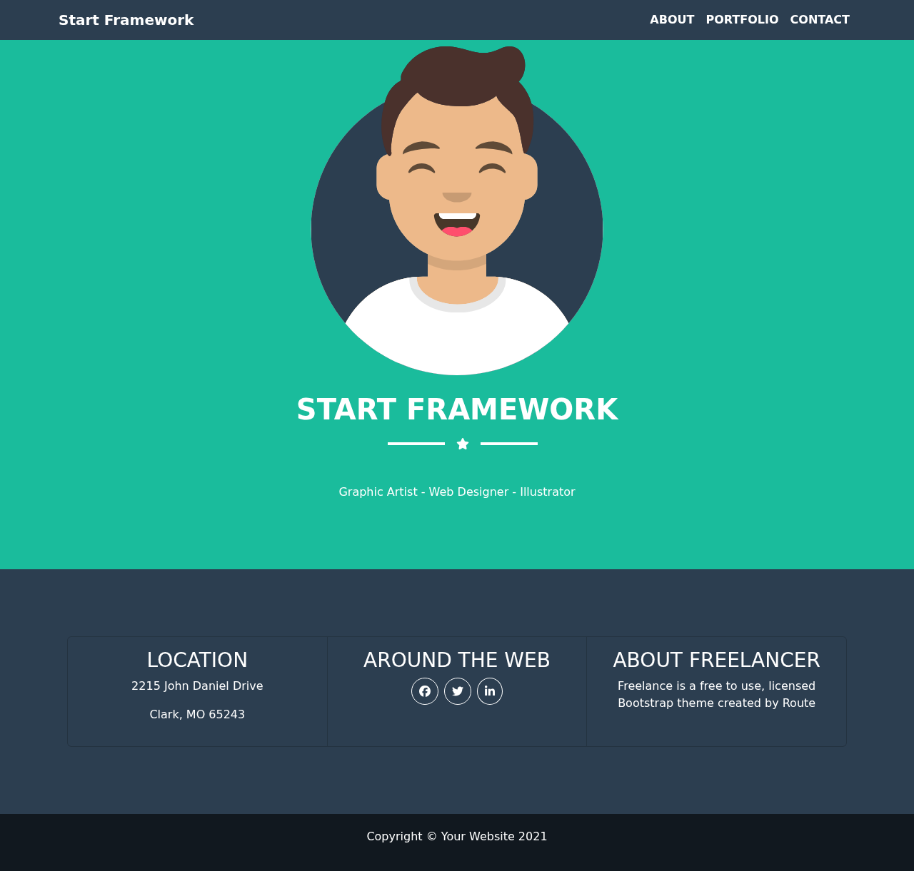
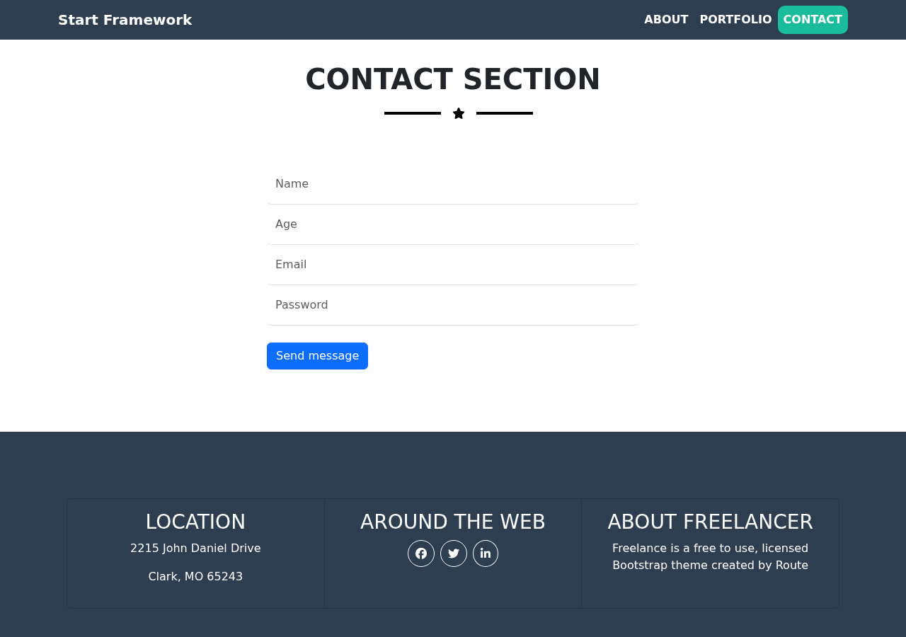
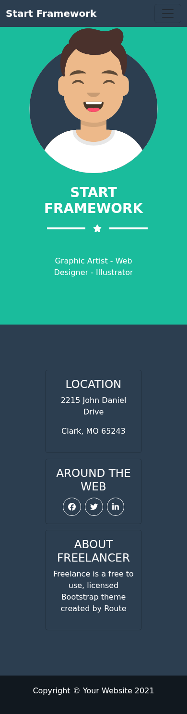

# Start Framework

The Start Framework landing page rebuilt as a single-page React app, with client-side
routing between Home, About, Portfolio and Contact sections. Originally a Bootstrap
theme exercise, reworked into clean React components.

**Live demo:** https://malakmo7amed309.github.io/start-framework/

## Screenshots

| Home | Contact |
| --- | --- |
|  |  |

| Mobile |
| --- |
|  |

## Features

- Four routed sections with a shared layout (React Router)
- Reusable star-divider component used across section headers
- Portfolio gallery with image modal
- Contact form UI with Bootstrap floating-style inputs
- Responsive navbar with mobile collapse menu
- Custom 404 page

## Tech stack

- React 18 + Vite
- React Router 7
- Bootstrap 5
- Font Awesome

## Getting started

```bash
npm install
npm run dev
```

Then open http://localhost:5173

Production build:

```bash
npm run build
npm run preview
```

## Author

Malak Mohamed - [GitHub](https://github.com/malakmo7amed309)
